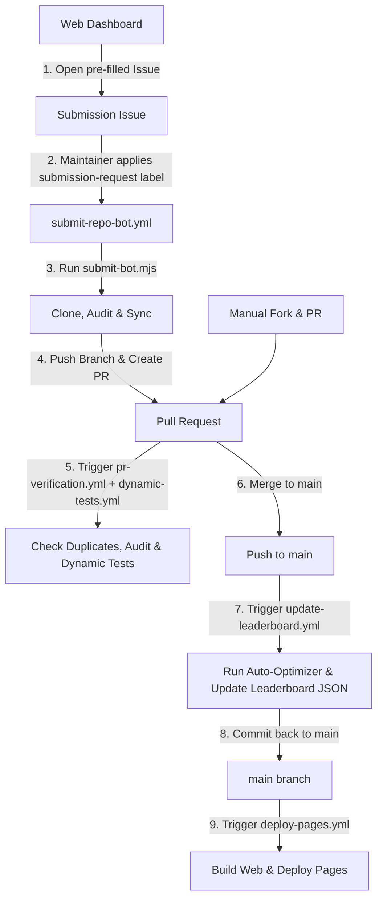

# 🤖 GitHub Actions Leaderboard CI Bot Guide

SkillGauge uses a modular, multi-workflow GitHub Actions CI pipeline designed to handle automated, PR-driven repository submissions securely, run verification checks on manual contributions, maintain the global leaderboard ranking database, and deploy the web interface.

---

## 🔄 Pipeline Architecture & Submission Flow

The system splits responsibilities into dedicated GitHub Actions workflows to ensure clean separation of concerns, security isolation, and optimal performance:

---

## ⚙️ Workflow Modules Reference

All workflow files are stored in the [.github/workflows/](file:///.github/workflows/) directory.

### 1. PR Submission Bot (`submit-repo-bot.yml`)
This workflow processes repository submissions. The SkillGauge website opens a pre-filled `[Submission]` issue; a maintainer approves it by applying the `submission-request` label, which triggers this workflow to clone, evaluate, and open a submission Pull Request on behalf of the submitter. This design keeps credentials out of the public Pages bundle: no token is baked into the website, and the maintainer label acts as a human approval gate so anonymous visitors cannot spam the bot.

*   **Trigger**: `workflow_dispatch` with input `repository` (manual override), or `issues` `labeled` when the `submission-request` label is applied to a `[Submission]` issue (the repository URL is parsed from the issue body or title).
*   **Permissions**: `contents: write`, `pull-requests: write`, `issues: write` (to acknowledge the submission issue).
*   **Core Logic**:
    *   Clones the monorepo and sets up Node.js.
    *   Builds the `@skillgauge/core` and `@skillgauge/cli` packages.
    *   Executes the helper script [submit-bot.mjs](file:///scripts/submit-bot.mjs) which clones the target repository, extracts skill markdown files, audits them, syncs the web bundle, and creates a git commit.
    *   Pushes a branch named `contrib-<repo-name>` and opens/updates a Pull Request on GitHub.
*   **Author Identity**: Runs using a GitHub App token (`ThanhNguyxnAgent[bot]`) so that bot commits and PRs never appear as `github-actions[bot]`.

### 2. Manual PR Verification (`pr-verification.yml`)
This workflow validates incoming Pull Requests that modify files inside the `skills/` directory.

*   **Trigger**: `pull_request` on `opened` or `synchronize` affecting `skills/**/*.md`.
*   **Permissions**: `contents: read`, `pull-requests: write`.
*   **Core Logic**:
    *   Runs a duplication check (`check-duplicate`) to prevent plagiarized or duplicate skill prompt content.
    *   Audits all changed skills using the CLI tool and outputs a detailed Markdown report to the GitHub Actions Job Summary.

### 3. Update Leaderboard on Main (`update-leaderboard.yml`)
When a Pull Request is merged into the `main` branch, this workflow automatically optimizes prompts, syncs data bundles, and updates the leaderboard database.

*   **Trigger**: `push` on branch `main` affecting files in `skills/**/*.md`.
*   **Permissions**: `contents: write`.
*   **Core Logic**:
    *   Runs the CLI `optimize` command to apply standard heuristic and model-based optimizations to the prompts.
    *   Regenerates the JSON and JS data bundles using [sync-skills.js](file:///scripts/sync-skills.js).
    *   Executes the `update-leaderboard` CLI tool to write the new entry metadata, scores, and tiers into `leaderboard.json`.
    *   Commits and pushes the modified database back to `main`.

### 4. Re-Audit All Skills (`re-audit-all.yml`)
A manual workflow designed to recalculate scores for all existing skills in the repository when the scoring algorithm is updated.

*   **Trigger**: Manual trigger via `workflow_dispatch`.
*   **Permissions**: `contents: write`.
*   **Core Logic**:
    *   Performs a clean build of the core auditing engine and CLI.
    *   Re-audits all markdown files under `skills/` using the updated CLI, recalculating all scores.
    *   Preserves the original author and submission timestamp metadata for existing skills in `leaderboard.json` to prevent database pollution.
    *   Commits and pushes the updated leaderboard back to `main`.

### 5. Deploy Web Dashboard (`deploy-pages.yml`)
Compiles and deploys the frontend web interface.

*   **Trigger**: `push` on `main` affecting `packages/web/**`, `packages/core/**`, `leaderboard.json`, or the deploy script.
*   **Permissions**: `contents: read`, `pages: write`, `id-token: write`.
*   **Core Logic**:
    *   Builds the React application for production (no secrets are injected into the bundle).
    *   Uploads the output bundle (`packages/web/dist`) and deploys it to GitHub Pages.

### 6. Dynamic Runtime Tests (`dynamic-tests.yml`)
Runs dynamic LLM tests on skill prompt files using the Gemini API.

*   **Trigger**: `pull_request` (`opened`, `synchronize`, `reopened`) on bot-created `contrib-*` branches, or manual `workflow_dispatch`.
*   **Permissions**: `contents: read`.
*   **Core Logic**:
    *   Builds the `@skillgauge/core` and `@skillgauge/cli` packages.
    *   Runs the `dynamic-test` CLI command to evaluate the runtime output of skills using `secrets.GEMINI_API_KEY`.
    *   Asserts expected keywords and safeguards against jailbreak or system prompt extraction.

---

## 🔒 Security Configuration Guide

To enable automated PR creation and support repository dispatch calls, you must set up correct repository variables and secrets on GitHub:

### 1. Enable Pull Request Creation in Actions
By default, GitHub Actions are restricted from creating or approving Pull Requests. To lift this constraint:
1. Go to your repository **Settings** > **Actions** > **General**.
2. Scroll to the **Workflow permissions** section.
3. Select **Read and write permissions**.
4. Check **Allow GitHub Actions to create and approve pull requests**.
5. Click **Save**.

### 2. Web submissions need no secret
The website does not ship any credential: the Submit button opens a pre-filled `[Submission]` issue on this repository, and a maintainer starts the bot by applying the `submission-request` label. The legacy `SUBMIT_PAT` secret is no longer used and should be deleted — any token previously baked into the deployed bundle must be treated as compromised and revoked.
